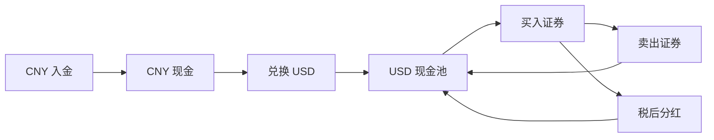

# Atlas Portfolio 开发方案

**版本：** v0.2（产品定义已确认；本地账本 MVP 已启动）  
**最近更新：** 2026-08-16  
**产品形态：** 桌面优先、移动端适配、可安装的个人投资 Web App  
**目标用户：** 第一阶段仅个人使用；管理海外证券、美元现金与人民币资金来源。验证成熟后再开放源代码至 GitHub。

## 1. 产品目标

建立一个以交易事实为基础的多币种海外证券组合管理系统，准确回答：

1. 从人民币入金开始，我的实际财富增长了多少？
2. 其中多少来自证券价格、分红、交易摩擦成本和 USD/CNY 汇率变化？
3. 卖出证券、分红后保留的美元现金，目前是多少，并带来了多少汇兑影响？
4. 不考虑人民币汇率时，我的 USD 投资决策本身表现如何？

系统不把“账户市值上涨”直接当作投资收益；入金、出金、换汇与证券收益必须分开处理。

## 2. 已确认的产品决策

| 项目 | 决策 |
|---|---|
| 使用形态 | 桌面 Web App 优先；手机浏览与录入适配；后续可做 PWA |
| 资金来源 | CNY 入金 |
| 投资/持仓货币 | 以 USD 为主，后续支持 HKD、其他货币 |
| 卖出与分红现金 | 暂留 USD 现金池，不自动兑换为 CNY |
| 主财富口径 | CNY 净资产、累计收益、CNY XIRR |
| 辅助投资口径 | USD 投资表现、USD TWR、证券交易损益 |
| 成本法 | MVP 默认移动平均成本；数据结构预留 FIFO/特定批次 |
| 汇率来源 | 实际换汇使用成交汇率；每日估值可录入 Google 汇率或指定银行牌价 |
| 证券识别 | ticker 自动匹配公司名称；以 ticker + 交易所 + 币种作为资产标识，支持人工修正 |
| 数据策略 | 本地优先；导入、导出和备份优先于账户注册与云同步 |

## 3. 核心资金模型

### 3.1 三类余额

- **CNY 现金**：入金后尚未换成 USD 的人民币。
- **USD 现金**：换汇得到、卖出证券和分红后暂未再投资的美元余额。
- **USD 证券**：股票、ETF、基金等按最新价格计算的美元市值。

当前人民币净资产：

\[
NAV_{CNY}=Cash_{CNY}+(Cash_{USD}+Securities_{USD})\times FX_{USD/CNY}
\]

累计 CNY 财富收益：

\[
P\&L_{CNY}=NAV_{CNY}-\sum CNY\ 入金+\sum CNY\ 出金
\]

### 3.2 收益归因

系统首页固定展示以下项目：

| 归因项目 | 处理方式 |
|---|---|
| 证券价格损益 | 已实现交易损益 + 未实现持仓损益；以 USD 计算，并提供 CNY 折算 |
| 净分红/利息 | 实际到账金额，扣除预扣税后进入 USD 现金池 |
| 交易摩擦成本 | 佣金、监管费、ADR fee、换汇点差及其他费用；单独归集 |
| 证券汇兑影响 | USD 证券市值相对其成本期汇率的 CNY 翻译影响 |
| USD 现金汇兑影响 | 卖出、分红及换汇形成的 USD 现金在持有期间的 CNY 翻译影响 |

对于卖出后继续保留的美元现金，系统必须把卖出日之后的汇率变化归入 **USD 现金汇兑影响**，而非证券价格损益。

### 3.3 回报率

- **CNY XIRR（主指标）**：以 CNY 入金/出金与当前 CNY 净资产为现金流，反映个人真实资金回报。
- **USD TWR（辅助指标）**：按估值时点与外部资金流计算，尽量剔除入金时点影响，反映投资决策表现。
- MVP 先完成累计收益和 CNY XIRR；在具备每日估值快照后加入严格 USD TWR。

## 4. MVP 功能范围

### 4.1 必做

1. **多币种交易账本**
   - CNY 入金、CNY 出金、CNY→USD 换汇
   - 买入、卖出、分红、利息、税费、佣金与其他费用
   - 每笔交易保存日期、账户、资产、数量、价格、币种、成交汇率、备注及来源

2. **现金与持仓计算**
   - CNY / USD 现金余额
   - 每一证券的数量、移动平均成本、当前市值、已实现/未实现损益
   - 支持混合资产：股票、ETF、基金及“其他”资产类型

3. **CNY 财富总览**
   - 累计 CNY 入金、当前 CNY 净资产、累计收益、累计收益率
   - USD 证券市值、USD 现金余额及其 CNY 参考价值
   - 证券损益、净分红、交易摩擦、汇率影响分项

4. **估值输入**
   - USD/CNY 每日参考汇率的录入、日期化保存和历史回溯
   - 证券最新价格的录入、日期化保存
   - 实际换汇交易必须使用成交汇率，而非每日参考汇率替代

5. **导入与备份**
   - 标准 CSV 导入模板
   - 账本和价格/汇率快照导出为 CSV / JSON
   - 本地备份与恢复

6. **资产识别**
   - 输入 ticker 后自动补全公司名称和基础信息
   - 对代码冲突或非美股资产，要求填写交易所和币种
   - 始终允许用户覆盖名称和资产类别

### 4.2 MVP 不做

- 自动下单或连接券商交易权限
- 投资建议、自动买卖信号、税务申报结论
- 多用户协作、社交功能
- 无差别抓取“实时”价格并将其伪装成实时成交价
- 原生 iOS / Android App

## 5. 数据模型

### 5.1 主表

| 表 | 关键字段 | 用途 |
|---|---|---|
| `accounts` | account_id, broker, base_currency | 区分 IBKR、银行及未来多个账户 |
| `assets` | asset_id, ticker, exchange, currency, name, type, ISIN | 避免仅用 ticker 造成代码冲突 |
| `ledger_entries` | entry_id, date, event_type, account_id, asset_id, quantity, cash_currency, cash_amount, fx_rate, fee, tax | 不可变的交易事实来源 |
| `cash_lots` | lot_id, currency, amount, originating_event, CNY_cost_basis | 支撑 USD 现金的汇兑归因 |
| `position_lots` | asset_id, quantity, USD_cost, CNY_cost, acquisition_fx | 支撑未来 FIFO / 特定批次与审计 |
| `price_snapshots` | asset_id, date, price, currency, source | 计算估值、历史净值和 TWR |
| `fx_snapshots` | pair, date, rate, source, rate_type | 记录 Google/银行/实际成交三类口径 |

### 5.2 事件类型

`CNY_DEPOSIT`、`CNY_WITHDRAWAL`、`FX_TO_USD`、`FX_TO_CNY`、`BUY`、`SELL`、`DIVIDEND`、`INTEREST`、`WITHHOLDING_TAX`、`COMMISSION`、`ADR_FEE`、`CORPORATE_ACTION`。

## 6. 技术方案

### 6.1 第一阶段技术栈

- **前端：** React + TypeScript，响应式桌面优先界面。
- **本地数据：** IndexedDB（优先）或 SQLite/WASM；不只依赖 LocalStorage。
- **计算引擎：** 独立 TypeScript 模块，输入账本和估值快照，输出余额、损益和归因；必须有单元测试。
- **导入导出：** CSV / JSON；先实现标准模板，再适配 IBKR Flex Query / Activity Statement。
- **部署：** 私有 Web App；不要求公开访问。

### 6.2 个人试用与 GitHub 开源策略

第一阶段以个人试用为唯一目标。代码已在 GitHub 私有仓库中维护；公开发布仍需等待个人测试成熟：

- 不需要账号系统、多用户、支付或公开网站。
- 当前原型的交易记录保存在浏览器 `localStorage`，仅用于小规模功能验证；在录入较多真实历史前，必须先完成 JSON 导出/导入，并迁移至 IndexedDB。
- 每次结构性更新前提醒导出 JSON/CSV 备份；浏览器清除站点数据或更换设备前必须先备份。
- 不把实际持仓、账户号码、IBKR 报表、访问令牌或个人备份文件提交到代码仓库。

私有 GitHub 仓库只包含：源代码、匿名模拟数据、导入模板、测试用例、部署说明和隐私说明；真实数据目录通过 `.gitignore` 排除。完成安全检查、备份能力和使用文档后，再决定是否公开。

### 6.3 后续扩展

- PWA 离线缓存、主屏幕安装与本地加密。
- 可选加密云备份与多设备同步。
- 证券与汇率数据适配器：保存来源、抓取时间、币种、时区和可编辑覆盖值。
- 如确有移动高频需求，再用 Capacitor 或 React Native 复用业务逻辑封装 App。

## 7. 开发阶段与验收标准

### Phase 0 — 计算规则与测试样例

**交付：** 数据字典、事件定义、五个标准测试案例。  
**验收：** 手工表格和程序对同一笔“CNY 入金→换 USD→买入→卖出→USD 留存→分红”的余额和 P&L 完全一致。

### Phase 1 — 本地账本 MVP

**交付：** 交易录入、编辑/删除、CNY/USD 现金余额、持仓和移动平均成本。  
**验收：** 任何一笔交易变更后，现金、持仓数量和成本基础均可追溯；导出后可恢复同一结果。

### Phase 2 — 估值与收益归因

**交付：** 价格/汇率快照、CNY 净资产、证券损益、分红、费用、USD 现金汇兑影响。  
**验收：** USD 现金在不买证券时仍会随 USD/CNY 变化影响 CNY 净资产；不发生实际换汇时不虚构 USD 现金流。

### Phase 3 — 回报率与报告

**交付：** CNY XIRR、历史净值、按资产/年份/收益来源的归因报表、CSV 导出。  
**验收：** 外部入金不会被误算成投资收益；XIRR 与同一现金流的独立表格计算一致。

### Phase 4 — IBKR 导入与数据适配器

**交付：** IBKR CSV/Flex Query 映射、导入预览、重复记录检测、自动补全资产名称。  
**验收：** 导入不会重复入账；原始券商字段可回链到生成的账本记录；异常记录必须提示用户确认。

### Phase 5 — 体验与可选同步

**交付：** PWA、备份提醒、可选加密同步、移动端查看优化。  
**验收：** 离线可浏览既有账本；换设备后能从备份完整恢复；敏感数据不在页面或日志中明文暴露。

### Phase 6 — GitHub 发布准备（在个人测试成熟后）

**交付：** 匿名演示数据、安装与备份说明、导入模板、测试套件、开源许可证和隐私说明。  
**验收：** 使用全新浏览器环境可用演示数据完成安装和测试；代码历史、样例、截图和文档均不含真实账户或交易数据。

## 8. 首个开发迭代

下一步先实施 **Phase 0 + Phase 1 的最小闭环**：

1. ✅ 固定 TypeScript 账本事件定义，并建立匿名测试账本；
2. ✅ 编写 CNY/USD 现金、移动平均成本、卖出盈亏和费用的纯计算函数；
3. ✅ 用确认过的资金路径建立测试数据，并在网页中验证结果；
4. ✅ 将桌面 Web 界面连接到计算引擎，加入本地账本读取、CNY 入金与空白个人账本初始化；
5. ⏳ 下一步：录入 CNY→USD 换汇；随后录入买入、卖出、分红和费用；
6. ⏳ 在输入较多真实记录前，先完成 JSON 导出/导入备份，再评估 IndexedDB 迁移；
7. ⏳ 在交易与备份可靠后，进入价格、汇率、CNY 净资产、汇兑归因和 XIRR 页面。

这可以确保后续的视觉设计、自动补全和数据更新都建立在正确的会计与收益归因基础上。

## 10. 当前实现节点（2026-08-16）

已验证并推送到私有 GitHub 仓库的节点包括：

- `d3502a6 feat: initialize empty personal ledger`：匿名演示账本与空白个人账本分离；个人 CNY 入金在浏览器本地保存。
- `4269581 docs: add project status handoff`：仓库内新增 `docs/PROJECT_STATUS.md`，用于新窗口或未来协作的快速交接。

下一开发任务是 **CNY→USD 换汇表单**：录入日期、实际支付 CNY 与实际收到 USD，并将两种现金余额的变化写入本地账本。每一个小功能仍按“实现 → `npm run build` → 浏览器验证 → 精确 `git add` → commit → push”的循环推进。

## 9. 共同开发与学习流程

本项目采用“边做边学”的方式，而不是先要求掌握完整的编程与 GitHub 知识。

### 9.1 每个开发小循环

每个小功能都按相同顺序推进：

1. **确定一个小目标**：例如“录入 CNY 入金并显示 CNY 现金余额”。
2. **解释设计**：说明它在资金模型中的位置、涉及的数据字段和计算规则。
3. **实现与讲解代码**：代码保持在小范围内；解释关键文件、函数、输入输出和常见错误。
4. **本地运行与验收**：使用一组可手算的匿名数据验证结果；你确认页面与数字符合预期。
5. **保存版本**：把通过验证的代码提交到 Git，写清楚本次改变了什么。
6. **记录下一步**：把未做的工作保留在任务清单，不混入已验证版本。

你的角色不是只做“验收者”。在每轮结束时，你可以选择做三类动作：运行项目、修改一项小参数/文案、或用自己的匿名测试数据复核。这样会逐步建立对项目结构的直觉。

### 9.2 Git 与 GitHub 的最小学习路径

- **Git** 是电脑上记录代码历史的工具：可以查看变化、保存一个可回退版本、比较前后差异。
- **GitHub** 是远程保存 Git 仓库的平台：用于备份、跨设备同步和未来公开代码。
- 一次 `commit` 是本地的“存档点”；一次 `push` 才是把已存档的代码上传到 GitHub。
- 真实投资数据不会随代码自动上传；它必须由 `.gitignore` 排除，并通过独立的本地备份保存。

建议按以下顺序学习和使用：

| 阶段 | 你学习的操作 | 目的 |
|---|---|---|
| 第 1 周 | `git status`、`git diff` | 看懂哪些文件变了、具体变了什么 |
| 第 1 周 | `git add`、`git commit` | 保存一个通过测试的小功能 |
| 第 2 周 | 创建 GitHub 私有仓库、`git push` | 远程备份代码，不上传真实数据 |
| 第 2 周后 | 分支与 Pull Request | 在尝试较大功能时不影响稳定版本 |
| 项目成熟后 | Release、README、匿名示例 | 为未来公开 GitHub 做准备 |

### 9.3 初学者的仓库规则

1. `main` 只保留你自己已经验证、可正常使用的版本。
2. 每个提交只处理一个主题；提交信息使用“动作 + 对象”，例如 `feat: calculate USD cash FX impact`。
3. 每次提交前至少运行一次相关测试或手工验收。
4. 提交前先检查 `git status`，确认没有 `data/`、报表、账户文件、密钥或导出备份。
5. 不会的 Git 操作先问；优先新建分支或备份，不使用破坏性命令覆盖历史。

### 9.4 我会如何配合

每次实现时，我会明确告诉你：

- 这次功能解决什么问题；
- 修改了哪些文件，以及各文件为什么存在；
- 你应如何运行、验证和观察结果；
- 应提交的文件范围与建议提交信息；
- 哪些文件绝不能上传到 GitHub。

在你准备首次使用 GitHub 时，我会带你完成一次私有仓库初始化、首次提交和首次推送；不会要求你把密码、令牌或真实投资数据发到对话中。
