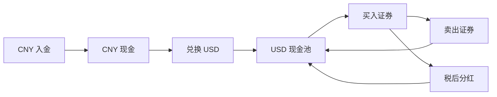

# Atlas Portfolio 开发方案

**版本：** v0.5（补充绩效指标定义与 Performance 页面口径）

**最近更新：** 2026-08-30

**产品形态：** 桌面优先、移动端适配、可安装的个人投资 Web App  
**目标用户：** 第一阶段仅个人使用；管理海外证券、美元现金与人民币资金来源。验证成熟后再开放源代码至 GitHub。

## 1. 产品目标

建立一个以交易事实为基础的多币种海外证券组合管理系统，准确回答：

1. 从人民币入金开始，我的实际财富增长了多少？
2. 其中多少来自证券价格、分红、交易摩擦成本和 USD/CNY 汇率变化？
3. 卖出证券、分红后保留的美元现金，目前是多少，并带来了多少汇兑影响？
4. 不考虑人民币汇率时，我的 USD 投资决策本身表现如何？

系统不把“账户市值上涨”直接当作投资收益；入金、出金、换汇与证券收益必须分开处理。

## 2. 已确认的产品决策

| 项目 | 决策 |
|---|---|
| 使用形态 | 桌面 Web App 优先；手机浏览与录入适配；后续可做 PWA |
| 资金来源 | CNY 入金 |
| 投资/持仓货币 | 以 USD 为主，后续支持 HKD、其他货币 |
| 卖出与分红现金 | 暂留 USD 现金池，不自动兑换为 CNY |
| 主财富口径 | CNY 净资产、累计收益、CNY XIRR |
| 辅助投资口径 | USD 投资表现、USD TWR、证券交易损益 |
| 组合风险口径 | SPX Delta 表示组合收益率相对 SPX 收益率的估算敏感度；同时展示 SPX ±1% 情景下的组合百分比和金额变化 |
| 成本法 | MVP 默认移动平均成本；数据结构预留 FIFO/特定批次 |
| 汇率来源 | 实际换汇使用成交汇率；每日估值可录入 Google 汇率或指定银行牌价 |
| 证券识别 | ticker 自动匹配公司名称；以 ticker + 交易所 + 币种作为资产标识，支持人工修正 |
| 数据策略 | 本地优先；导入、导出和备份优先于账户注册与云同步 |
| 市场数据策略 | Free-First 且不采用付费 API；低频更新、本地缓存、供应商可替换，可靠的免费延迟/EOD 数据优先于来源不明的实时行情 |
| 开发原则 | **Function-first, usability-always, polish-later**：核心功能和数据正确性优先，基础可用性始终保证，视觉精修集中后置 |

### 2.1 信息架构与统一交易流程

Atlas 在核心功能开发期间即固定页面职责和主要操作路径，避免数据模型稳定后再因页面结构不适用而大幅返工。当前只建立清楚、可测试的基础界面，不提前投入字体、色彩、阴影、动画和品牌视觉等精修工作。

桌面端采用左侧固定导航，页面职责固定为：

1. **Dashboard**：组合总值、现金、损益、数据新鲜度和需要处理的异常概览；
2. **Portfolio**：持仓数量、成本、当前价格、市值及已实现/未实现损益；
3. **Transactions**：完整账本、筛选、交易详情，以及唯一的编辑/删除入口；
4. **Cash**：各币种余额、现金流水、利息、费用、入金、出金和换汇记录；
5. **Performance**：累计收益、回报率、历史曲线、基准比较和 SPX Delta；
6. **Market Data**：价格、估值汇率、来源、更新时间、缓存状态、刷新和人工覆盖；
7. **Settings**：备份恢复、数据管理、provider 配置及其他本地设置。

桌面端全局提供统一的 **Add transaction** 入口。手机端底部导航优先展示 Dashboard、Portfolio、Transactions 和 Cash，其余页面进入 **More**。

所有交易统一采用以下流程：

1. 选择交易类型；
2. 按业务含义分组填写表单；
3. 预览保存后对现金、持仓、成本、损益和费用的影响；
4. 确认并保存。

买入表单固定分为 **基本信息、标的、成交信息、成本与备注**。其他交易类型沿用相同的分组原则，但只显示与该类型有关的字段。

交易编辑与删除只允许在 Transactions 的交易详情页执行。保存修改或确认删除后，系统必须以账本为事实来源执行全局重新计算，不得只修改当前页面显示值。涉及历史数据结构升级时，还必须保留 schema 版本、迁移路径和备份提示。

## 3. 核心资金模型

### 3.1 三类余额

- **CNY 现金**：入金后尚未换成 USD 的人民币。
- **USD 现金**：换汇得到、卖出证券和分红后暂未再投资的美元余额。
- **USD 证券**：股票、ETF、基金等按最新价格计算的美元市值。

当前人民币净资产：

\[
NAV_{CNY}=Cash_{CNY}+(Cash_{USD}+Securities_{USD})\times FX_{USD/CNY}
\]

累计 CNY 财富收益：

\[
P\&L_{CNY}=NAV_{CNY}-\sum CNY\ 入金+\sum CNY\ 出金
\]

### 3.2 收益归因

系统首页固定展示以下项目：

| 归因项目 | 处理方式 |
|---|---|
| 证券价格损益 | 已实现交易损益 + 未实现持仓损益；以 USD 计算，并提供 CNY 折算 |
| 净分红/利息 | 实际到账金额，扣除预扣税后进入 USD 现金池 |
| 交易摩擦成本 | 佣金、监管费、ADR fee、换汇点差及其他费用；单独归集 |
| 证券汇兑影响 | USD 证券市值相对其成本期汇率的 CNY 翻译影响 |
| USD 现金汇兑影响 | 卖出、分红及换汇形成的 USD 现金在持有期间的 CNY 翻译影响 |

对于卖出后继续保留的美元现金，系统必须把卖出日之后的汇率变化归入 **USD 现金汇兑影响**，而非证券价格损益。

### 3.3 回报率

- **NAV** 回答“当前组合值多少钱”；**累计 P&L** 回答“累计赚亏多少钱”；两者都不是收益率。
- **CNY XIRR / MWR（主资金回报指标）**：以投资者视角的 CNY 外部现金流与当前 CNY 净资产计算，反映实际投入资金经历的回报。
- **USD TWR（主要策略表现指标）**：按估值时点与外部现金流切分子周期并几何链接，尽量剔除资金投入时点影响，反映投资决策与资产配置表现。
- MVP 先完成累计收益和 CNY XIRR；在具备足够频率、可重算的估值快照后加入严格 USD TWR。TWR 与 XIRR 使用不同数学口径，两者差值不得直接命名为“择时 Alpha”。

#### 3.3.1 外部现金流边界

Portfolio 级收益率必须先固定组合边界，再区分外部现金流和组合内部交易。当前 Atlas 的组合边界是应用内管理的全部投资账户；未纳入 Atlas 的银行账户属于边界之外。

计入外部现金流：

- 外部银行账户向 Atlas 投资组合入金；
- Atlas 投资组合向外部银行账户提款；
- 未来导入券商记录时，经过去重后确认的资本追加或资本取回。

不计入外部现金流：

- 买入、卖出和不同证券之间的调仓；
- CNY、USD、HKD 之间的组合内部换汇；
- Atlas 已追踪账户之间的内部转账；
- 现金分红、利息及其再投资；
- 佣金、ADR 托管费、税费和其他投资成本。

分红和利息是投资收益，留在组合时增加现金；再投资仍记录为收益事件加买入事件。只有随后实际转出组合边界的提款，才作为外部现金流。费用和税费是组合回报的拖累，而不是外部提款。未来支持多个账户时，内部转账必须以关联记录去重，不能在组合级别同时虚增入金和出金。

#### 3.3.2 指标关系与现金流符号

以统一估值货币表示时：

\[
Portfolio\ NAV=Cash+Market\ Value\ of\ Holdings+Other\ Assets-Liabilities
\]

\[
Net\ Contributions=Cumulative\ External\ Deposits-Cumulative\ External\ Withdrawals
\]

\[
Total\ P\&L=Ending\ NAV+Cumulative\ External\ Withdrawals-Cumulative\ External\ Deposits
\]

XIRR 输入统一采用投资者视角：入金为负现金流，提款为正现金流，估值期末的 Portfolio NAV 作为最后一笔正现金流。内部计算即使采用其他存储符号，也必须在指标边界统一转换并用独立样例核对。

TWR 在每个外部现金流边界切分子周期：

\[
TWR=\prod_i(1+r_i)-1
\]

实施前必须在独立技术规范中固定现金流发生在期初或期末时的处理规则、同日多笔现金流顺序，以及缺少现金流前估值点时的降级方式，避免前端根据不完整快照输出看似精确的 TWR。

#### 3.3.3 年化、多币种与数据质量

- 累计收益率与年化收益率必须分开显示；年化阈值、持有不足一年时的展示方式和日期计数约定必须写入技术规范。
- 每条 NAV、TWR、XIRR 和基准序列都必须标注估值币种。不同币种的曲线不得直接比较。
- USD TWR 与 USD 权益基准比较时不引入 CNY 汇率；若展示 CNY 口径组合与基准，必须把双方按同一汇率来源、同一估值日期转换为 CNY。
- 汇率变化属于 CNY 财富回报的一部分，但不得混入“不考虑人民币汇率”的 USD 策略表现。
- 行情或汇率缺失、过期或人工覆盖时，指标必须显示覆盖率和数据新鲜度；无法形成完整 NAV 时不得静默沿用旧值并输出完整收益率。
- 每日收盘快照是可重建的派生数据，不是账本事实。修改历史交易、公司行动、价格或汇率后，从最早受影响日期起重新计算后续 NAV 和回报序列，并保留计算版本与输入来源。

### 3.4 SPX Delta 风险暴露

SPX Delta 用于估计整个投资组合收益率相对标普500指数收益率的变动敏感度，不代表保证发生的盈亏，也不替代压力测试。

第一版支持股票和 ETF：

\[
SPX\ Delta=\frac{\sum_i MarketValue_{USD,i}\times Beta_{i,SPX}}{PortfolioNAV_{USD}}
\]

\[
Expected\ Portfolio\ Change_{USD}=PortfolioNAV_{USD}\times SPX\ Delta\times SPX\ Return
\]

- `SPX Delta = 1.2` 表示 SPX 变动 1% 时，组合预计同方向变动约 1.2%；`SPX Delta = 0.7` 表示组合敏感度较低。
- 多头股票/ETF 的原始 delta 为 1；现金 beta 为 0，但现金包含在 `PortfolioNAV_USD` 分母中，因此会降低整个组合的 SPX Delta。当前账本不支持空头，未来支持后按负方向处理。
- `Beta_{i,SPX}` 使用统一频率和观察窗口的历史收益率估计；初始默认可采用约 252 个交易日日收益，但窗口必须可配置并在界面显示。
- 若资产 beta、资产价格或 SPX 参考点位缺失，该资产标记为未覆盖；组合指标必须同时显示已覆盖市值占比，不能把缺失值静默当作 0。
- 每次结果保存 `as_of`、beta 窗口、样本数、数据 provider、原始机构/基准、抓取时间和是否过期。
- 未来加入期权账本后，单个期权先计算 `contracts × multiplier × option_delta × underlying_price × underlying_beta` 的 SPX 敏感金额，再纳入组合 SPX Delta；期权 delta 必须带时间戳，允许人工覆盖，并明确盘中过期风险。
- 页面主要展示 SPX Delta，并辅助展示 SPX 上涨/下跌 1% 时组合预计变动的百分比和美元金额、未调整净股票市值及覆盖率。
- “组合实际收益率 − SPX 实际收益率”属于相对收益，不得与 SPX Delta 混为同一指标。

### 3.5 Performance 页面指标层级与基准

Performance 页面按职责分为四层，避免把资产规模、绝对盈亏、收益率和风险暴露混在一起：

1. **当前状态**：Portfolio NAV、Net Contributions、Total P&L、Cash、Invested Assets；
2. **投资表现**：累计回报、TWR、MWR / XIRR，并提供简短口径说明；
3. **基准比较**：Portfolio TWR、Benchmark Total Return、Excess Return；
4. **风险暴露**：SPX Delta、SPX ±1% 情景和市值覆盖率，与实际超额收益明确分区。

\[
Excess\ Return=Portfolio\ TWR-Benchmark\ Total\ Return
\]

基准分为两类：

- **权益策略基准**：第一优先为 S&P 500；后续可选 NASDAQ-100、MSCI ACWI、MSCI World，以及合法免费数据可覆盖的自定义 ETF / 指数；
- **低风险机会成本基准**：美国国债、中国国债和中国一年期定期存款。

权益基准用于衡量投资策略相对市场的表现；利率和存款基准用于比较低风险机会成本，两类含义不得混用。所有比较曲线统一以 100 为起点，并明确是否采用总回报/分红再投资、币种、汇率、复利、起止日期、节假日对齐和数据来源。若只能取得价格指数而非总回报指数，界面必须明确说明其未计入分红，不能与含分红的组合 TWR 假装完全可比。

## 4. MVP 功能范围

### 4.1 必做

1. **多币种交易账本**
   - CNY 入金、CNY 出金、CNY→USD 换汇
   - 买入、卖出、分红、利息、税费、佣金与其他费用
   - 每笔交易保存日期、账户、资产、数量、价格、币种、成交汇率、备注及来源

2. **现金与持仓计算**
   - CNY / USD 现金余额
   - 每一证券的数量、移动平均成本、当前市值、已实现/未实现损益
   - 支持混合资产：股票、ETF、基金及“其他”资产类型

3. **CNY 财富总览**
   - 累计 CNY 入金、当前 CNY 净资产、累计收益、累计收益率
   - USD 证券市值、USD 现金余额及其 CNY 参考价值
   - 证券损益、净分红、交易摩擦、汇率影响分项

4. **估值输入**
   - USD/CNY 每日参考汇率的录入、日期化保存和历史回溯
   - 证券最新价格的录入、日期化保存
   - 实际换汇交易必须使用成交汇率，而非每日参考汇率替代

5. **导入与备份**
   - 标准 CSV 导入模板
   - 账本和价格/汇率快照导出为 CSV / JSON
   - 本地备份与恢复

6. **资产识别**
   - 输入 ticker 后自动补全公司名称和基础信息
   - 对代码冲突或非美股资产，要求填写交易所和币种
   - 始终允许用户覆盖名称和资产类别

### 4.2 MVP 不做

- 自动下单或连接券商交易权限
- 投资建议、自动买卖信号、税务申报结论
- 多用户协作、社交功能
- 无差别抓取“实时”价格并将其伪装成实时成交价
- 原生 iOS / Android App

## 5. 数据模型

### 5.1 主表

| 表 | 关键字段 | 用途 |
|---|---|---|
| `accounts` | account_id, broker, base_currency | 区分 IBKR、银行及未来多个账户 |
| `assets` | asset_id, ticker, exchange, currency, name, type, ISIN | 避免仅用 ticker 造成代码冲突 |
| `ledger_entries` | entry_id, date, event_type, account_id, asset_id, quantity, cash_currency, cash_amount, fx_rate, fee, tax | 不可变的交易事实来源 |
| `cash_lots` | lot_id, currency, amount, originating_event, CNY_cost_basis | 支撑 USD 现金的汇兑归因 |
| `position_lots` | asset_id, quantity, USD_cost, CNY_cost, acquisition_fx | 支撑未来 FIFO / 特定批次与审计 |
| `price_snapshots` | asset_id, date, price, currency, source | 计算估值、历史净值和 TWR |
| `fx_snapshots` | pair, date, rate, source, rate_type | 记录 Google/银行/实际成交三类口径 |
| `market_data_cache` | instrument_id, value, currency, market_timestamp, fetched_at, provider, source_institution, expires_at | 统一缓存股票、ETF、汇率和未来基准数据 |
| `portfolio_snapshots` | date, cash_by_currency, securities_value, NAV_CNY, NAV_USD, external_cash_flow, net_contributions, P&L, FX_effect, calculation_version | 保存可重算的每日组合状态，支撑历史净值、TWR 和走势图 |
| `benchmark_snapshots` | benchmark_id, date, level, total_return_level, currency, source, fetched_at | 保存权益与低风险基准序列及其可比口径 |
| `provider_usage` | provider, date, request_count, request_budget, last_error | 控制免费 API 调用预算并记录限流/失败情况 |
| `risk_factor_snapshots` | instrument_id, benchmark, beta, window, observations, as_of, provider, fetched_at | 保存可审计的 SPX beta 与未来其他因子暴露 |

### 5.2 事件类型

`CNY_DEPOSIT`、`CNY_WITHDRAWAL`、`FX_TO_USD`、`FX_TO_CNY`、`BUY`、`SELL`、`DIVIDEND`、`INTEREST`、`WITHHOLDING_TAX`、`COMMISSION`、`ADR_FEE`、`CORPORATE_ACTION`。

## 6. 技术方案

### 6.1 第一阶段技术栈

- **前端：** React + TypeScript，响应式桌面优先界面。
- **本地数据：** IndexedDB（优先）或 SQLite/WASM；不只依赖 LocalStorage。
- **计算引擎：** 独立 TypeScript 模块，输入账本和估值快照，输出余额、损益和归因；必须有单元测试。
- **导入导出：** CSV / JSON；先实现标准模板，再适配 IBKR Flex Query / Activity Statement。
- **部署：** 私有 Web App；不要求公开访问。

### 6.2 个人试用与 GitHub 开源策略

第一阶段以个人试用为唯一目标。代码已在 GitHub 私有仓库中维护；公开发布仍需等待个人测试成熟：

- 不需要账号系统、多用户、支付或公开网站。
- 当前原型的交易记录保存在浏览器 `localStorage`，仅用于小规模功能验证；在录入较多真实历史前，必须先完成 JSON 导出/导入，并迁移至 IndexedDB。
- 每次结构性更新前提醒导出 JSON/CSV 备份；浏览器清除站点数据或更换设备前必须先备份。
- 不把实际持仓、账户号码、IBKR 报表、访问令牌或个人备份文件提交到代码仓库。

私有 GitHub 仓库只包含：源代码、匿名模拟数据、导入模板、测试用例、部署说明和隐私说明；真实数据目录通过 `.gitignore` 排除。完成安全检查、备份能力和使用文档后，再决定是否公开。

### 6.3 Free-First 市场数据策略

Atlas 是个人长期投资账户管理工具，不是专业交易终端。市场数据模块遵循以下顺序：

1. 免费公开数据；
2. 无需 Key 的免费 API；
3. 有免费额度且无需付费的 API；
4. 免费来源不可用时使用本地缓存或手动录入。

Atlas 不采购付费 API、付费行情订阅或专业实时行情。若免费数据无法覆盖某项资产，该资产使用人工价格和明确的数据新鲜度标记，不以付费升级作为解决方案。

当前估值、未实现损益、累计收益和历史增长分析允许使用延迟行情、小时级更新或上一交易日收盘价。MVP 不需要 tick、Level II、秒级 WebSocket 或交易所直连数据。

#### 6.3.1 架构边界

- 建立统一 `MarketDataProvider` 接口；Portfolio Engine 只接收标准化数据，不依赖供应商字段。
- 股票/ETF 与 FX 使用独立 provider，不要求同一服务覆盖所有市场。
- 标准返回至少包含：`instrument_id`、`symbol/pair`、`value`、`currency`、`market_timestamp`、`fetched_at`、`provider`、`source_institution` 和 `is_delayed`。
- Provider 配置、TTL 和每日请求预算不得硬编码进 Portfolio Engine。
- API Key 仅保存在本地安全配置中，不写入源码、备份、日志或 GitHub。

#### 6.3.2 刷新、缓存与失败降级

第一阶段只提供“启动时按需刷新一次 + 用户手动刷新”。所有页面共享本地缓存，不因页面切换重复调用 API。

初始 TTL 原则：

| 数据 | 初始策略 |
|---|---|
| 股票/ETF 最新价 | 30–60 分钟；若供应商仅提供 EOD，则按交易日更新 |
| FX 参考汇率 | 6–24 小时 |
| 已确认的历史日线/历史汇率 | 永久保存，只追加缺失日期 |

失败降级链固定为：Primary Provider → Secondary Provider → 未过期缓存 → 过期缓存并明确标记 → Manual Override。任何自动值和人工值都必须保留来源、市场时间和抓取时间。

#### 6.3.3 数据源选择与许可

- FX 首选免费、公开且可追溯到官方机构的参考汇率服务；Frankfurter 作为第一候选，接入时分别保存数据服务和原始机构。
- 股票/ETF 第一轮验证候选为 Alpha Vantage、Twelve Data 或届时更合适的合法延迟/EOD provider。
- 具体免费额度、市场覆盖、延迟级别和许可条款会变化；每次正式接入前必须重新查阅官方文档，不把当前额度写成永久产品假设。
- 不把网页 HTML scraping 作为核心行情来源；开源或公开部署前重新审核 API 条款、缓存许可和再分发限制。
- 数据源评价顺序：合法性、正确性、稳定性、成本、覆盖范围、更新速度。

截至 2026-08-21，Frankfurter 官方文档说明公共 API 无需 Key、提供历史汇率和 provider attribution；这支持其作为 FX 架构验证候选，但实际所需 USD/CNY、USD/HKD 覆盖及来源机构仍须在接入验收时逐项确认。

#### 6.3.4 API 预算与免费边界

- 初始目标预算：Stock API ≤ 20 次/日，FX API ≤ 5 次/日，AI API 默认 0 次。
- 即使服务没有硬性日限额，也按低频预算运行，减少限流和供应商依赖。
- 免费调用量不足、市场无法覆盖或服务中断时，依次使用请求合并、延长 TTL、备用免费 provider、缓存和 Manual Override。
- 若未来需求必须依赖付费数据，该功能保持未实现并重新讨论产品范围；不得自动启用试用、订阅或产生费用。

#### 6.3.5 市场数据实施顺序

1. `MarketDataProvider` 抽象接口与统一返回模型；
2. IndexedDB 本地 Market Cache；
3. 免费 FX Provider；
4. 免费/免费额度 Stock Provider；
5. Refresh、TTL、数据新鲜度展示；
6. API 使用预算与错误记录；
7. Portfolio Valuation；
8. Daily Portfolio Snapshot；
9. Provider fallback 与 Manual Override；
10. 定期复核免费来源的覆盖、许可和稳定性；无法覆盖的项目保留 Manual Override。

### 6.4 后续扩展

- PWA 离线缓存、主屏幕安装与本地加密。
- 可选加密云备份与多设备同步。
- 证券与汇率数据适配器：保存来源、抓取时间、币种、时区和可编辑覆盖值。
- 如确有移动高频需求，再用 Capacitor 或 React Native 复用业务逻辑封装 App。

## 7. 开发阶段与验收标准

### Phase 0 — 计算规则与测试样例

**交付：** 数据字典、事件定义、五个标准测试案例。  
**验收：** 手工表格和程序对同一笔“CNY 入金→换 USD→买入→卖出→USD 留存→分红”的余额和 P&L 完全一致。

### Phase 1 — 本地账本 MVP

**交付：** 交易录入、编辑/删除、CNY/USD 现金余额、持仓和移动平均成本。  
**验收：** 任何一笔交易变更后，现金、持仓数量和成本基础均可追溯；导出后可恢复同一结果。

### Phase 2 — Free-First 市场数据、估值与收益归因

**交付：** Provider 抽象、本地缓存、免费 FX/股票 provider、TTL/手动刷新、API 预算、价格/汇率快照、CNY 净资产、证券损益、分红、费用、USD 现金汇兑影响和每日组合快照。

**验收：** 页面切换不会重复调用 API；历史数据只追加缺失日期；provider 失败时可使用有明确新鲜度标记的缓存或人工价格；USD 现金在不买证券时仍会随 USD/CNY 变化影响 CNY 净资产；不发生实际换汇时不虚构 USD 现金流。

### Phase 2.5 — 基础信息架构与统一交易入口

**启动条件：** 完成 IndexedDB Market Cache、免费估值汇率、证券价格、数据新鲜度和组合 Market Value 的基本估值链路后再开始；不得为了导航重构打断当前市场数据小循环。

**交付：** 桌面端左侧固定导航、手机端底部导航与 More、七个职责明确的页面容器、全局 Add transaction、统一的“选择类型 → 分组填写 → 预览影响 → 保存”流程，以及 Transactions 详情页中的编辑/删除入口。现有已验证表单逐步接入统一入口，不在同一提交中一次性迁移全部交易类型。

**验收：** 用户可从任意主要页面开始新增交易；保存前能看到可核对的账本影响；编辑或删除后现金、持仓、平均成本、损益和费用均由完整账本重新计算；桌面和手机的核心页面可达；本阶段不以视觉美化作为验收条件。

### Phase 3 — 回报率与报告

**前置规范：** 先建立并长期维护 `docs/PERFORMANCE_METRICS.md`，固定外部现金流边界、TWR 子周期算法、XIRR 正负号、累计与年化规则、多币种换算、分红/利息/费用/税费处理、基准可比性、缺失数据降级和历史快照重算策略；规范通过匿名手算样例后再连接 UI。

**交付：** Portfolio NAV、Net Contributions、Total P&L、CNY XIRR / MWR、USD TWR、历史净值与收益率折线、按资产/年份/收益来源的归因报表、CSV 导出、SPX Delta 及 SPX ±1% 情景风险卡片，以及可配置的基准比较。权益策略基准先支持 S&P 500，再评估 NASDAQ-100、MSCI ACWI、MSCI World 和自定义 ETF / 指数；低风险机会成本基准包括美国国债、中国国债和中国一年期定期存款。所有曲线统一以 100 为起点并明确总回报假设、币种、汇率、复利和数据来源。

**验收：** 外部入金不会被误算成投资收益，买卖、换汇、分红和再投资不会被误算成外部现金流；XIRR 与同一现金流的独立表格计算一致；TWR 与独立子周期样例一致，外部入金金额变化不应直接改变同日策略回报；NAV、Net Contributions 和 Total P&L 满足已定义的勾稽关系；组合与基准采用一致日期范围、币种和分红口径，不能把价格指数冒充总回报指数，也不能把某日利率直接冒充累计收益；历史交易或估值修正后能从最早受影响日期确定性重算；SPX Delta 与独立计算样例一致，并显示估值日期、beta 窗口、样本数、数据新鲜度和市值覆盖率，缺失因子时不得输出看似完整的组合风险值。

### Phase 4 — IBKR 导入与数据适配器

**交付：** IBKR CSV/Flex Query 映射、导入预览、重复记录检测、自动补全资产名称。  
**验收：** 导入不会重复入账；原始券商字段可回链到生成的账本记录；异常记录必须提示用户确认。

### Phase 5 — 体验与可选同步

**交付：** PWA、备份提醒、可选加密同步、移动端查看优化。  
**验收：** 离线可浏览既有账本；换设备后能从备份完整恢复；敏感数据不在页面或日志中明文暴露。

### Phase 6 — GitHub 发布准备（在个人测试成熟后）

**交付：** 匿名演示数据、安装与备份说明、导入模板、测试套件、开源许可证和隐私说明。  
**验收：** 使用全新浏览器环境可用演示数据完成安装和测试；代码历史、样例、截图和文档均不含真实账户或交易数据。

## 8. 首个开发迭代

下一步先实施 **Phase 0 + Phase 1 的最小闭环**：

1. ✅ 固定 TypeScript 账本事件定义，并建立匿名测试账本；
2. ✅ 编写 CNY/USD 现金、移动平均成本、卖出盈亏和费用的纯计算函数；
3. ✅ 用确认过的资金路径建立测试数据，并在网页中验证结果；
4. ✅ 将桌面 Web 界面连接到计算引擎，加入本地账本读取、CNY 入金与空白个人账本初始化；
5. ⏳ 下一步：录入 CNY→USD 换汇；随后录入买入、卖出、分红和费用；
6. ⏳ 在输入较多真实记录前，先完成 JSON 导出/导入备份，再评估 IndexedDB 迁移；
7. ⏳ 在交易与备份可靠后，进入价格、汇率、CNY 净资产、汇兑归因和 XIRR 页面。

这可以确保后续的视觉设计、自动补全和数据更新都建立在正确的会计与收益归因基础上。

## 10. 当前实现节点（2026-08-16）

已验证并推送到私有 GitHub 仓库的节点包括：

- `d3502a6 feat: initialize empty personal ledger`：匿名演示账本与空白个人账本分离；个人 CNY 入金在浏览器本地保存。
- `4269581 docs: add project status handoff`：仓库内新增 `docs/PROJECT_STATUS.md`，用于新窗口或未来协作的快速交接。

下一开发任务是 **CNY→USD 换汇表单**：录入日期、实际支付 CNY 与实际收到 USD，并将两种现金余额的变化写入本地账本。每一个小功能仍按“实现 → `npm run build` → 浏览器验证 → 精确 `git add` → commit → push”的循环推进。

## 9. 共同开发与学习流程

本项目采用“边做边学”的方式，而不是先要求掌握完整的编程与 GitHub 知识。

### 9.1 每个开发小循环

每个小功能都按相同顺序推进：

1. **确定一个小目标**：例如“录入 CNY 入金并显示 CNY 现金余额”。
2. **解释设计**：说明它在资金模型中的位置、涉及的数据字段和计算规则。
3. **实现与讲解代码**：代码保持在小范围内；解释关键文件、函数、输入输出和常见错误。
4. **本地运行与验收**：使用一组可手算的匿名数据验证结果；你确认页面与数字符合预期。
5. **保存版本**：把通过验证的代码提交到 Git，写清楚本次改变了什么。
6. **记录下一步**：把未做的工作保留在任务清单，不混入已验证版本。

你的角色不是只做“验收者”。在每轮结束时，你可以选择做三类动作：运行项目、修改一项小参数/文案、或用自己的匿名测试数据复核。这样会逐步建立对项目结构的直觉。

### 9.2 Git 与 GitHub 的最小学习路径

- **Git** 是电脑上记录代码历史的工具：可以查看变化、保存一个可回退版本、比较前后差异。
- **GitHub** 是远程保存 Git 仓库的平台：用于备份、跨设备同步和未来公开代码。
- 一次 `commit` 是本地的“存档点”；一次 `push` 才是把已存档的代码上传到 GitHub。
- 真实投资数据不会随代码自动上传；它必须由 `.gitignore` 排除，并通过独立的本地备份保存。

建议按以下顺序学习和使用：

| 阶段 | 你学习的操作 | 目的 |
|---|---|---|
| 第 1 周 | `git status`、`git diff` | 看懂哪些文件变了、具体变了什么 |
| 第 1 周 | `git add`、`git commit` | 保存一个通过测试的小功能 |
| 第 2 周 | 创建 GitHub 私有仓库、`git push` | 远程备份代码，不上传真实数据 |
| 第 2 周后 | 分支与 Pull Request | 在尝试较大功能时不影响稳定版本 |
| 项目成熟后 | Release、README、匿名示例 | 为未来公开 GitHub 做准备 |

### 9.3 初学者的仓库规则

1. `main` 只保留你自己已经验证、可正常使用的版本。
2. 每个提交只处理一个主题；提交信息使用“动作 + 对象”，例如 `feat: calculate USD cash FX impact`。
3. 每次提交前至少运行一次相关测试或手工验收。
4. 提交前先检查 `git status`，确认没有 `data/`、报表、账户文件、密钥或导出备份。
5. 不会的 Git 操作先问；优先新建分支或备份，不使用破坏性命令覆盖历史。

### 9.4 我会如何配合

每次实现时，我会明确告诉你：

- 这次功能解决什么问题；
- 修改了哪些文件，以及各文件为什么存在；
- 你应如何运行、验证和观察结果；
- 应提交的文件范围与建议提交信息；
- 哪些文件绝不能上传到 GitHub。

在你准备首次使用 GitHub 时，我会带你完成一次私有仓库初始化、首次提交和首次推送；不会要求你把密码、令牌或真实投资数据发到对话中。
